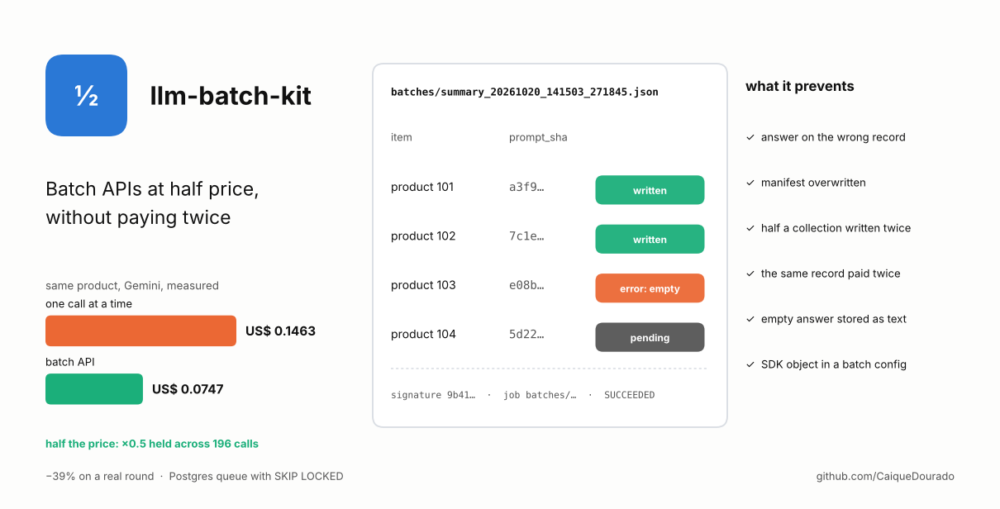
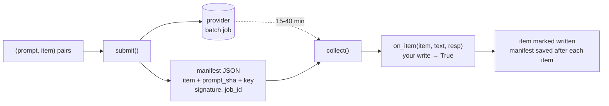
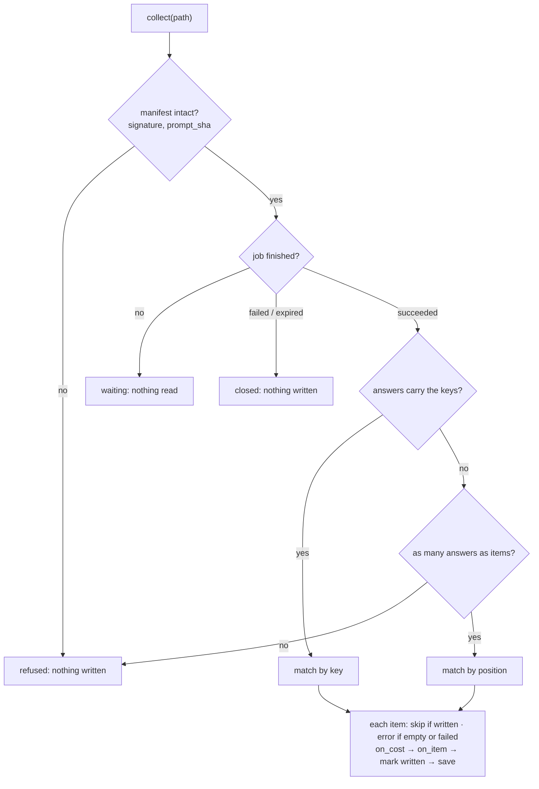
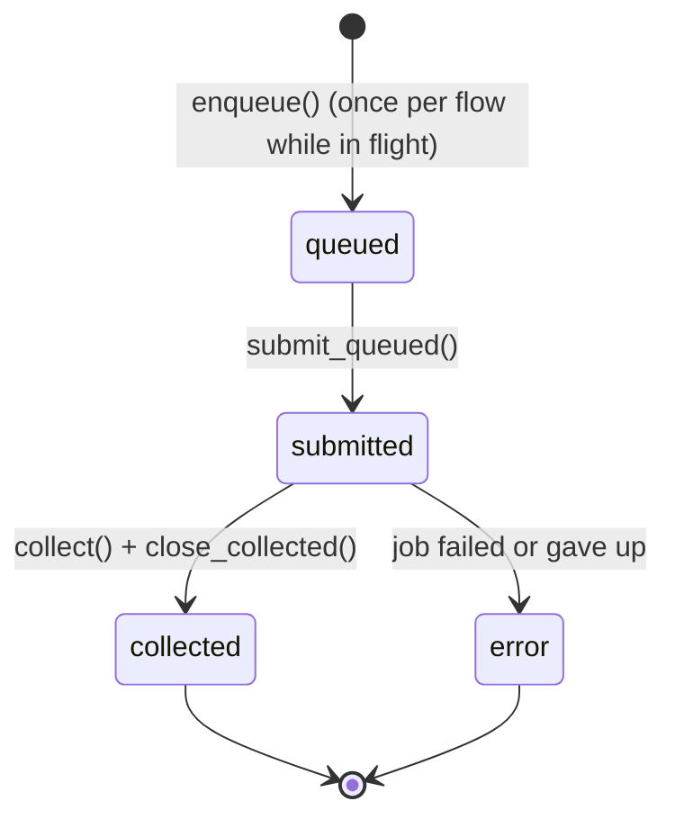

# llm-batch-kit

[](https://github.com/CaiqueDourado/llm-batch-kit/actions/workflows/tests.yml)
[](LICENSE)
[](pyproject.toml)

[Leia em português](README.pt-BR.md)



Use the provider's Batch API (half the price of the same calls made one by one) without the two ways it
loses money: **answers written on the wrong record** and **the same work paid twice**.

```python
from llm_batch_kit import GeminiBatch, submit, collect, manifest

gemini = GeminiBatch()                                   # GEMINI_API_KEY from the environment

# now: ONE list of (prompt, item) pairs, never two parallel lists
tasks = [(f"Summarise the reviews of {p['name']}", {"product_id": p["id"]}) for p in products]
path, man = submit("summary", "gemini-2.5-flash", tasks, gemini,
                   config={"thinking_config": {"thinking_budget": 0}})

# 15-40 minutes later, as many times as you like
def store(item, text, resp):                             # your write; True = stored
    db.execute("update products set summary = %s where id = %s", (text, item["product_id"]))
    return True

for path, _ in manifest.pending(flow="summary"):
    print(collect(path, gemini, store))                  # written=…, skipped=…, errors=…
```

## Where it comes from

The author's product-review site writes spec sheets, comparisons, rankings and video scripts with Gemini.
A study to cut that bill measured, on the same product, **US$ 0.1463 synchronous and US$ 0.0747 in batch**:
the batch discount held at **×0.5 across 196 calls**. On a real production round the saving was **−39%**
(US$ 0.6300 → 0.3843), because only the prose step could wait; batch and a shorter prompt together gave
**−74.8%**.

The discount is easy. Collecting is where it went wrong:

| What happened | What the library does |
|---|---|
| Gemini's inline batch has **no request id**: answers come back in the order of the requests. The first version kept prompts in one list and product ids in another, and the docstring warned that "swapping either side gives one product's answer to another, silently" | `submit` takes **one list of `(prompt, item)` pairs**: there are no two sides to drift. Each item keeps the hash of its prompt; a manifest edited or reordered after submission is refused |
| Image edits went **one job per product** (inline requests are capped at 20 MB, and the reference photos travel in base64), about 204 jobs per pass. Manifest names had one-second resolution, so two jobs submitted in the same second wrote the same file: **a paid job with nothing left to collect it** | names with microseconds, created with `O_EXCL`; a collision is impossible, not unlikely |
| A collection that dies halfway, collected again, writes the first half twice | the manifest is rewritten (atomically) **after every item**; written items are skipped |
| A double click, a retry or a second admin tab queued the same record twice: **two paid jobs for one result** | a Postgres queue with a **partial unique index**: a record can be in flight once per flow |
| `resp.text` raises, or returns `None`, when the answer is an image | `text_of()` and `images_of()` read the parts |
| An empty answer was written as empty content over good text | no text and no image is an error, not content |
| `types.ThinkingConfig` inside a batch request fails: batch takes plain dicts in snake_case | `check_config()` refuses it before you pay for a failed job |
| Submission and collection times written as local time without offset in a `timestamptz` column: **durations came out negative** (−02:51:02) | UTC with offset in the manifest; the queue uses the database's `now()` |
| Job states written as free text drifted three times (`success`, `completed`, `stopped`) | the queue has a `CHECK` on four states |

This library is that batch layer, rewritten as a package with the lessons above as code and tests.

## How it works



What `collect` does with a manifest:



**Matching by key.** The SDK's inline request has a `metadata` field. `GeminiBatch(keys=True)` sends each
item's key there; if the answers come back with it, `collect` matches by key and order stops mattering.
This is not yet checked against a real job, so it is off by default and the position checks stay.

## The queue: never pay twice for one record

For apps where a click asks for work (an admin grid, a checklist): the click writes an intent and returns
at once; a collector turns queued rows into jobs.



```python
import psycopg
from llm_batch_kit import Queue, submit_queued, close_collected, collect

q = Queue(psycopg.connect(dsn))
q.create()                                        # batch_queue table, partial unique index
q.enqueue("summary", "products", 42, requested_by="grid")   # id, or None if 42 is already in flight
q.in_flight("products", page_ids)                 # {"42": ["summary"]}: what the grid shows per row

paths = submit_queued(q, "summary", lambda row: (prompt_for(row["record_id"]), {"product_id": row["record_id"]}),
                      "gemini-2.5-flash", gemini)        # rows without args in one job; rows with args alone
for p in paths:                                   # later
    collect(p, gemini, store)
    close_collected(q, p)                         # written → collected; failed job → error (can be queued again)
```

`take()` uses `FOR UPDATE SKIP LOCKED` on Postgres, so two collectors never take the same rows. SQLite works
too, for tests and small setups. `llm-batch-kit ddl postgres` prints the table.

## Cost

Answers can be recorded with [llm-cost-kit](https://github.com/CaiqueDourado/llm-cost-kit) at the batch
price, one row per answer:

```python
from llm_cost_kit import Ledger, PriceTable, SQLiteSink
from llm_batch_kit import ledger_hook

ledger = Ledger(PriceTable.load("prices.yaml"), SQLiteSink("costs.sqlite"))
collect(path, gemini, store, on_cost=ledger_hook(ledger, "gemini-2.5-flash", "summary", ("product_id",)))
```

If recording the cost fails, the item is still written: a lost cost row is lost information, not lost
content.

## One assembly path

A pattern from the same project, kept as advice rather than code: build the request and use the answer
with **the same function** in the synchronous path, at submission and at collection. "Submit and collect
assembling differently is an invisible bug."

```python
def build(product):                      # used to submit, and to call synchronously in tests
    return prompt_for(product), {"product_id": product["id"]}

def store(item, text, resp):             # used at collection, and after a synchronous call
    ...
```

## Install

```bash
pip install "llm-batch-kit[gemini] @ git+https://github.com/CaiqueDourado/llm-batch-kit"
pip install "llm-batch-kit[gemini,postgres] @ git+https://github.com/CaiqueDourado/llm-batch-kit"   # with the queue
```

No dependencies without extras: the manifest, the queue on SQLite and `FakeBatch` run on the standard library.

## Command line

```bash
llm-batch-kit status                 # pending manifests per flow: written/items, attempts, job id
llm-batch-kit check                  # manifests that are unsafe to collect (no network)
llm-batch-kit collect --handlers myflows:HANDLERS --once
llm-batch-kit collect --handlers myflows:HANDLERS --loop --interval 900 --health collector.json
llm-batch-kit ddl postgres
```

`HANDLERS` is a dict `{flow: on_item}` (see [examples/flows.py](examples/flows.py)). A finished job whose
items keep failing to write is closed after `--max-attempts` collections (default 3), so it does not come
back forever. `--health` rewrites a small JSON after every cycle for a status page.

## Testing without the provider

`FakeBatch` keeps jobs in memory and can misbehave on purpose: reorder answers, drop one, fail a request,
end a job as `EXPIRED`. The tests use it to check every row of the table above;
[examples/quickstart.py](examples/quickstart.py) runs offline with it.

## Limits

- **Gemini only, for now.** OpenAI and Anthropic batches return a `custom_id` with each answer, so the
  order problem does not exist there; the manifest and the queue would still help. Adapters are welcome.
- Without echoed keys, an answer list that comes back **in a different order with the same length** cannot
  be detected. The count check and the signature catch everything else.
- Only inline requests. Very large jobs (file input in Cloud Storage) are not covered.

## Related

- [llm-cost-kit](https://github.com/CaiqueDourado/llm-cost-kit): what each call really cost, with prices you can trace; records these answers at the batch price.

## License

[MIT](LICENSE) © Caique Dourado
