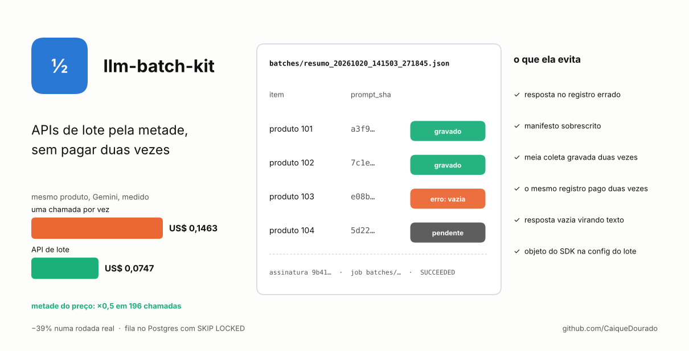
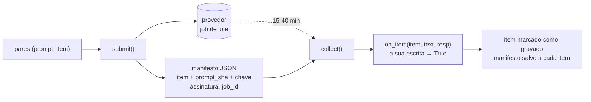
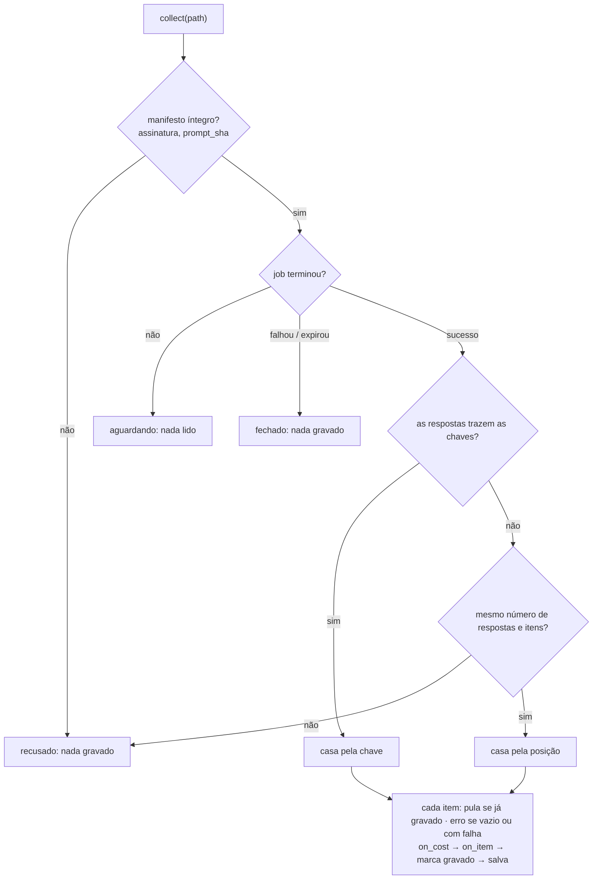
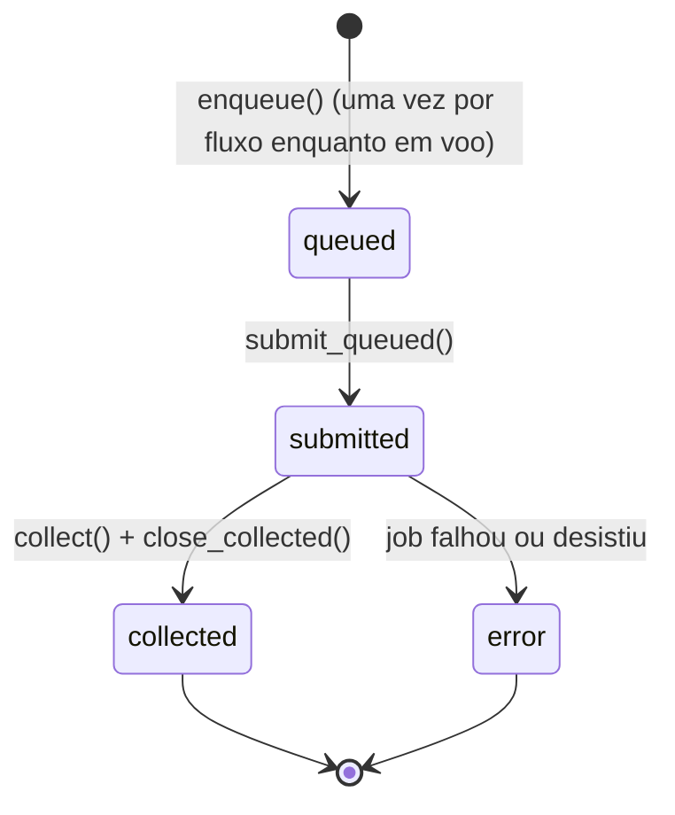

# llm-batch-kit

[](https://github.com/CaiqueDourado/llm-batch-kit/actions/workflows/tests.yml)
[](LICENSE)
[](pyproject.toml)

[Read in English](README.md)



Use a API de lote do provedor (metade do preço das mesmas chamadas feitas uma a uma) sem as duas formas
como ela perde dinheiro: **resposta gravada no registro errado** e **o mesmo trabalho pago duas vezes**.

```python
from llm_batch_kit import GeminiBatch, submit, collect, manifest

gemini = GeminiBatch()                                   # GEMINI_API_KEY do ambiente

# agora: UMA lista de pares (prompt, item), nunca duas listas paralelas
tasks = [(f"Resuma as avaliações de {p['name']}", {"product_id": p["id"]}) for p in products]
path, man = submit("resumo", "gemini-2.5-flash", tasks, gemini,
                   config={"thinking_config": {"thinking_budget": 0}})

# de 15 a 40 minutos depois, quantas vezes quiser
def grava(item, text, resp):                             # a sua escrita; True = gravou
    db.execute("update products set resumo = %s where id = %s", (text, item["product_id"]))
    return True

for path, _ in manifest.pending(flow="resumo"):
    print(collect(path, gemini, grava))                  # written=…, skipped=…, errors=…
```

## De onde vem

O site de análises de produtos do autor escreve fichas técnicas, comparativos, rankings e roteiros de vídeo
com o Gemini. Um estudo para cortar essa conta mediu, no mesmo produto, **US$ 0,1463 síncrono e US$ 0,0747
em lote**: o desconto do lote se manteve em **×0,5 em 196 chamadas**. Numa rodada real de produção a
economia foi de **−39%** (US$ 0,6300 → 0,3843), porque só a etapa de texto podia esperar; lote e prompt mais
curto juntos deram **−74,8%**.

O desconto é fácil. A coleta é que deu errado:

| O que aconteceu | O que a biblioteca faz |
|---|---|
| O lote inline do Gemini **não tem id de pedido**: as respostas voltam na ordem dos pedidos. A primeira versão guardava os prompts numa lista e os ids dos produtos em outra, e o próprio comentário avisava que "trocar a ordem de qualquer um dos dois lados associa a resposta de um produto ao outro, em silêncio" | `submit` recebe **uma lista de pares `(prompt, item)`**: não existem dois lados para desalinhar. Cada item guarda o hash do seu prompt; manifesto editado ou reordenado depois da submissão é recusado |
| Edição de imagem foi para **um job por produto** (o pedido inline tem teto de 20 MB e as fotos de referência vão em base64), cerca de 204 jobs por passada. O nome do manifesto tinha resolução de um segundo, então dois jobs submetidos no mesmo segundo gravavam o mesmo arquivo: **job pago e nada para colhê-lo** | nome com microssegundos, criado com `O_EXCL`; colisão passa a ser impossível, não improvável |
| Coleta que morre no meio, colhida de novo, grava a primeira metade duas vezes | o manifesto é regravado (de forma atômica) **depois de cada item**; item gravado é pulado |
| Clique duplo, nova tentativa ou segunda aba do admin enfileiravam o mesmo registro duas vezes: **dois jobs pagos para um resultado** | fila no Postgres com **índice único parcial**: um registro só fica em voo uma vez por fluxo |
| `resp.text` levanta erro, ou devolve `None`, quando a resposta é imagem | `text_of()` e `images_of()` leem as partes |
| Resposta vazia era gravada como conteúdo vazio por cima de texto bom | sem texto e sem imagem é erro, não conteúdo |
| `types.ThinkingConfig` dentro de pedido de lote falha: o lote aceita dict puro em snake_case | `check_config()` recusa antes de você pagar por um job que falha |
| Horários de submissão e coleta gravados em hora local sem fuso numa coluna `timestamptz`: **as durações saíam negativas** (−02:51:02) | UTC com fuso no manifesto; a fila usa o `now()` do banco |
| Estado de job em texto livre divergiu três vezes (`success`, `completed`, `stopped`) | a fila tem `CHECK` com quatro estados |

Esta biblioteca é essa camada de lote, reescrita como pacote, com as lições acima virando código e teste.

## Como funciona



O que o `collect` faz com um manifesto:



**Casar pela chave.** O pedido inline do SDK tem um campo `metadata`. `GeminiBatch(keys=True)` manda ali a
chave de cada item; se as respostas voltarem com ela, o `collect` casa pela chave e a ordem deixa de
importar. Isso ainda não foi conferido num job real, então vem desligado e as checagens de posição
continuam.

## A fila: nunca pagar duas vezes pelo mesmo registro

Para apps em que um clique pede trabalho (uma grade de admin, um checklist): o clique grava a intenção e
volta na hora; um coletor transforma as linhas da fila em jobs.



```python
import psycopg
from llm_batch_kit import Queue, submit_queued, close_collected, collect

q = Queue(psycopg.connect(dsn))
q.create()                                        # tabela batch_queue, índice único parcial
q.enqueue("resumo", "products", 42, requested_by="grid")   # id, ou None se o 42 já está em voo
q.in_flight("products", ids_da_pagina)            # {"42": ["resumo"]}: o que a grade mostra em cada linha

paths = submit_queued(q, "resumo", lambda row: (prompt_de(row["record_id"]), {"product_id": row["record_id"]}),
                      "gemini-2.5-flash", gemini)        # linhas sem args num job; com args, cada uma sozinha
for p in paths:                                   # depois
    collect(p, gemini, grava)
    close_collected(q, p)                         # gravado → collected; job que falhou → error (pode voltar à fila)
```

O `take()` usa `FOR UPDATE SKIP LOCKED` no Postgres, então dois coletores nunca pegam as mesmas linhas. SQLite
também funciona, para testes e instalações pequenas. `llm-batch-kit ddl postgres` imprime a tabela.

## Custo

As respostas podem ser registradas com a [llm-cost-kit](https://github.com/CaiqueDourado/llm-cost-kit) pelo
preço de lote, uma linha por resposta:

```python
from llm_cost_kit import Ledger, PriceTable, SQLiteSink
from llm_batch_kit import ledger_hook

ledger = Ledger(PriceTable.load("prices.yaml"), SQLiteSink("costs.sqlite"))
collect(path, gemini, grava, on_cost=ledger_hook(ledger, "gemini-2.5-flash", "resumo", ("product_id",)))
```

Se registrar o custo falhar, o item é gravado mesmo assim: linha de custo perdida é informação perdida, não
conteúdo perdido.

## Um caminho só para montar

Um padrão do mesmo projeto, deixado como conselho e não como código: monte o pedido e use a resposta com
**a mesma função** no caminho síncrono, na submissão e na coleta. "Submeter e colher montando diferente é um
bug invisível."

```python
def monta(produto):                      # usada para submeter e para chamar síncrono nos testes
    return prompt_de(produto), {"product_id": produto["id"]}

def grava(item, text, resp):             # usada na coleta e depois de uma chamada síncrona
    ...
```

## Instalação

```bash
pip install "llm-batch-kit[gemini] @ git+https://github.com/CaiqueDourado/llm-batch-kit"
pip install "llm-batch-kit[gemini,postgres] @ git+https://github.com/CaiqueDourado/llm-batch-kit"   # com a fila
```

Sem extras não há dependência: o manifesto, a fila no SQLite e o `FakeBatch` rodam só com a biblioteca padrão.

## Linha de comando

```bash
llm-batch-kit status                 # manifestos pendentes por fluxo: gravados/itens, tentativas, job
llm-batch-kit check                  # manifestos que não é seguro colher (sem rede)
llm-batch-kit collect --handlers meusfluxos:HANDLERS --once
llm-batch-kit collect --handlers meusfluxos:HANDLERS --loop --interval 900 --health coletor.json
llm-batch-kit ddl postgres
```

`HANDLERS` é um dict `{fluxo: on_item}` (veja [examples/flows.py](examples/flows.py)). Job terminado cujos
itens continuam falhando na gravação é fechado depois de `--max-attempts` coletas (padrão 3), para não
voltar para sempre. O `--health` regrava um JSON pequeno a cada ciclo, para uma tela de status.

## Testar sem o provedor

O `FakeBatch` guarda os jobs em memória e pode errar de propósito: reordenar respostas, perder uma, falhar
um pedido, terminar um job como `EXPIRED`. Os testes usam ele para conferir cada linha da tabela acima; o
[examples/quickstart.py](examples/quickstart.py) roda offline com ele.

## Limites

- **Só Gemini, por enquanto.** Os lotes da OpenAI e da Anthropic devolvem um `custom_id` com cada resposta,
  então o problema da ordem não existe lá; o manifesto e a fila ainda ajudariam. Adaptadores são bem-vindos.
- Sem chave ecoada, uma lista de respostas que volte **em outra ordem com o mesmo tamanho** não tem como ser
  detectada. A contagem e a assinatura pegam todo o resto.
- Só pedidos inline. Jobs muito grandes (entrada por arquivo no Cloud Storage) ficam de fora.

## Relacionados

- [llm-cost-kit](https://github.com/CaiqueDourado/llm-cost-kit): quanto cada chamada custou de verdade, com preços rastreáveis; registra estas respostas pelo preço de lote.

## Licença

[MIT](LICENSE) © Caique Dourado
